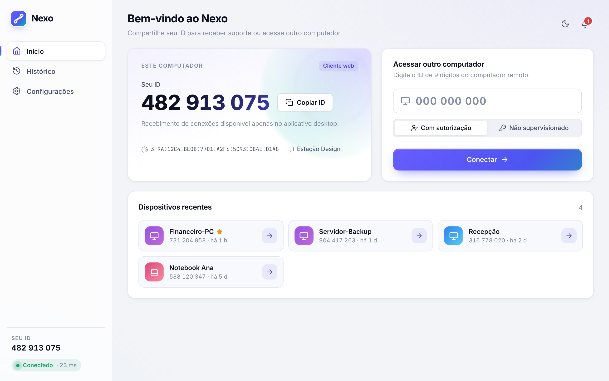

# Nexo — Acesso remoto

Software de acesso remoto com identidade própria: informe o ID de 9 dígitos de outro
computador, aguarde a autorização do proprietário e veja e controle a tela pela internet.
O tráfego é cifrado de ponta a ponta, com conexão direta (P2P) quando a rede permite e
relay TURN quando não permite.



## Funcionalidades

- **Conexão:** ID permanente por dispositivo (chave Ed25519), pedido com autorização
  explícita, aceitar ou recusar com permissões por sessão, modo não supervisionado opcional
  (senha + lista de IDs autorizados), reconexão automática (WebSocket e ICE restart),
  indicador de qualidade, latência e rota P2P/Relay.
- **Controle remoto:** vídeo H.264 em tempo real, mouse e teclado completos (mapeamento por
  tecla física), atalhos especiais (Ctrl+Alt+Del, Win, Alt+Tab, Ctrl+Shift+Esc, PrintScreen),
  colar texto, ajuste automático de resolução, tela cheia, vários monitores, qualidade e FPS.
- **Arquivos:** navegador do disco remoto, envio e recebimento de arquivos e **pastas**,
  barra de progresso, velocidade, tempo restante e cancelamento.
- **Comunicação:** chat durante a sessão e notificações de conexão e desconexão.
- **Histórico:** sessões com data, hora, duração, dispositivo e motivo de encerramento,
  além do registro de auditoria do servidor e do computador local.
- **Segurança:** TLS + DTLS-SRTP, SDP assinado com Ed25519 e *pinning* de chave, Argon2id,
  rate limits, bloqueio após senha errada, **janela indicadora sempre visível** com botão
  Encerrar no computador acessado. Detalhes em [docs/SECURITY.md](docs/SECURITY.md).
- **Configurações:** iniciar com o Windows, qualidade e FPS, permissões padrão, acesso não
  supervisionado, dispositivos autorizados, chaves confiáveis, conta, atualização automática,
  tema claro, escuro ou do sistema.

## Estrutura

```
server/     Backend Node/TypeScript: identidade, autenticação, sinalização, sessões, TURN, histórico
infra/      Docker Compose: PostgreSQL + servidor + coturn + Caddy (TLS)
core/       Núcleo Rust: captura, H.264, WebRTC (host), entrada, arquivos + agente nexo-hostd
desktop/    App Tauri 2: UI React/TS (src/) + shell nativo (src-tauri/)
e2e/        Teste ponta a ponta real (servidor + coturn + host real + UI no Chromium)
docs/       ARCHITECTURE · PROTOCOL · SECURITY · TESTING · screenshots
```

Arquitetura: [docs/ARCHITECTURE.md](docs/ARCHITECTURE.md) · Protocolo: [docs/PROTOCOL.md](docs/PROTOCOL.md)

## Começando (desenvolvimento)

Requisitos: Node 22, Rust estável, PostgreSQL 16 (ou Docker). No Windows, também o
Visual Studio Build Tools (C++) e o WebView2 (já incluso no Windows 11).

1. Servidor (sobe um Postgres local, aplica as migrações e inicia em `http://localhost:8080`):

   ```bash
   cd server && npm ci && scripts/dev.sh
   ```

   Ou com Docker: `cd infra && cp .env.example .env && docker compose up -d` (veja `infra/README.md`).

2. App desktop:

   ```bash
   cd desktop && npm ci && npx tauri dev
   ```

3. Instalador Windows (NSIS e MSI), apontando para o seu servidor:

   ```bash
   cd desktop && VITE_NEXO_SERVER=https://seu-dominio npx tauri build
   ```

   O workflow `.github/workflows/desktop-build.yml` gera os instaladores automaticamente.

4. Agente não supervisionado sem interface (servidores, máquinas sem monitor físico):

   ```bash
   cargo run -p nexo-core --features hostd --bin nexo-hostd -- --server https://seu-dominio --name Servidor01
   ```

   A senha vai na variável `NEXO_PASSWORD`.

A URL do servidor também pode ser alterada em **Configurações → Geral**.

## Testes

```bash
cd server && npm test
```

```bash
cargo test -p nexo-core
```

```bash
e2e/run.sh
```

```bash
HOST_KIND=desktop e2e/run.sh
```

Os testes ponta a ponta usam o host real e a interface real, por P2P e por relay TURN.
Veja [docs/TESTING.md](docs/TESTING.md), que também traz o roteiro de teste manual entre dois PCs Windows em redes diferentes.

## Limitações conhecidas / próximos passos

- Telas seguras do Windows (UAC, Ctrl+Alt+Del, tela de bloqueio) exigem um serviço Windows
  rodando como SYSTEM.
- Ainda faltam: transmissão de áudio, sincronização de área de transferência, captura via
  DXGI/WGC e codificação por hardware.
- OpenH264 compilado do código-fonte não tem a cobertura de patentes da Cisco. Veja SECURITY.md
  antes de distribuir comercialmente.
- O atualizador automático está configurado, mas precisa da sua chave pública e do endpoint
  em `desktop/src-tauri/tauri.conf.json`.
- O servidor guarda presença e sessões em memória, então roda em uma instância só. Para
  escalar horizontalmente, é preciso Redis ou pub/sub.
